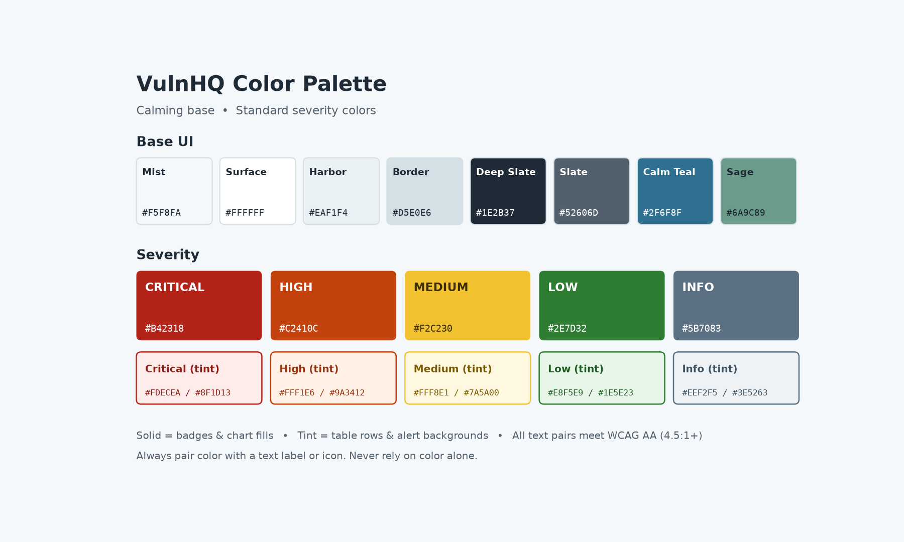

# VulnHQ

> **Find it. Rank it. Fix it. Prove it.**

VulnHQ is the headquarters for vulnerability management. Turn scanner noise into a ranked fix list, prioritize by real risk, drive remediation, and track every exposure to closure.


---

## Why VulnHQ

Most security teams don't have a finding problem. They have a **prioritization problem**. Scanners produce thousands of results, CVSS scores treat everything as urgent, and remediation teams can't tell what to fix first.

VulnHQ flips the model: **stop patching everything and fix what matters first.**

- **Signal over noise:** Consolidate findings from multiple sources into one view.
- **Risk-based ranking:** Prioritize by exploitability, asset criticality, and exposure, not CVSS alone.
- **Remediation that moves:** Assign owners, track SLAs, and break down the backlog.
- **Proof for leadership:** Show risk reduction, closure rates, and mean time to remediate (MTTR).

---

## Features

### Current (MVP)
- [x] Import assets and findings (JSON), with software-version to CVE matching (vetted rules plus live NVD lookup). See [importing](docs/importing.md).
- [x] Asset inventory with business criticality ratings (business context file)
- [x] Risk-based prioritization score (0 to 100, with factor breakdown)
- [x] Ranked fix list page with tier filters (Critical / High / Medium / Low)
- [x] Score details panel showing why each finding ranks where it does
- [x] Dashboard KPI cards (critical open, known exploited, overdue, stale scans, open findings)
- [x] Confidence column on every finding (confirmed / conditional / nvd)
- [x] Assets page with stale-scan flags, asset details panel and an "Add software" form
- [x] JSON import page in the UI (inventory and business context), with a check for files that have no software
- [x] Sidebar navigation; side panels close with Escape
- [ ] Dark mode
- [ ] Remediation status tracking (Open → In Progress → Fixed → Verified)

### Planned
- [x] CISA Known Exploited Vulnerabilities (KEV) catalog enrichment
- [x] EPSS (Exploit Prediction Scoring System) enrichment
- [x] SLA due dates by remediation tier (fix-by date, days remaining, overdue flag)
- [ ] Owner assignment and notifications
- [ ] Executive reporting: closure rate, MTTR, risk trend
- [ ] Scanner integrations (e.g., Tenable, Qualys, Rapid7, Snyk)
- [ ] Ticketing integrations (e.g., Jira, ServiceNow)
- [ ] Exception and risk-acceptance workflow
- [ ] NIST CSF 2.0 subcategory tagging and coverage view
- [ ] OWASP Top 10:2025 classification for AppSec findings
- [ ] OWASP Risk Rating scoring option

### Added from SRS review (v1 and v1.2)
See the full [SRS gap analysis](docs/srs-gap-analysis.md) for requirement IDs.

**Prioritization and matching**
- [ ] BOD 26-04 tier per finding (exposure, KEV, automatable, technical impact) from a versioned matrix file, with the score ordering work inside each tier (SRS Section 9)
- [ ] Add CVSS and time pressure to the score; plain-language "why it ranks here" sentence
- [ ] Show the KEV due date and flag it past due, separately from the company SLA
- [ ] Explicit Unknown exposure; compute the tier both ways and show the more urgent one
- [ ] Confidence levels Confirmed / Likely / Uncertain / Ruled out, with a separate "needs verification" lane
- [ ] Keep ruled-out CVE candidates with the reason instead of skipping them
- [ ] Coverage gaps with a recommended data source; distro backport handling (for example OpenSSL on RHEL)
- [ ] Vendor version translators (Java, Exchange CU, Cisco trains, OpenSSL letters)

**Data and enrichment**
- [ ] Data-quality report on import (counts, missing fields, departments vs. business units)
- [ ] Configurable as-of date; show it on every page
- [ ] Store KEV catalog version, raw NVD responses, EPSS percentile and model version
- [ ] SSVC Automatable and Technical Impact from CISA Vulnrichment
- [ ] CWE, MITRE ATT&CK and CTEM stage mapping per finding
- [ ] End-of-support flags; maintenance groups; environment (prod / dev)
- [ ] Daily KEV refresh; mark NVD cache entries older than 7 days stale

**Answers, trust and reporting**
- [ ] Natural-language questions answered by a deterministic router plus LLM, covering the 10 assignment questions (SRS Section 11)
- [ ] Citations and an evidence bundle per finding; answer verifier with Pass / Fail
- [ ] Package-level patch plan (package, target version, hosts, risk removed) and "simulate patch"
- [ ] Risk response type, scenario (routine, emergency patch, emergency mitigation, unpatchable) and forensic triage checklist for top-tier KEV findings
- [ ] Business-unit summary, 3-sentence cited CISO summary, CWE root-cause view
- [ ] "What this tool does not do" statement
- [ ] Audit log of questions, answers and configuration changes

**Owner features (SRS Sections 5.11 to 5.24)**
- [ ] Organization configuration: custom fields, tags, ID schemes, criticality model, formula editor with preview and approval
- [ ] Scan standards page with presets and warnings
- [ ] Manual review ticket queue for components that can't be assessed
- [ ] Notification center: email, Teams and Slack, routing rules, delivery log
- [ ] Ingestion API plus SARIF, CycloneDX SBOM and Burp parsers, with provenance
- [ ] Cross-tool correlation (SAST, DAST, WAF, pentest) into one issue
- [ ] SLA policy: rating schemes, clock rules, extensions, risk acceptance, SLA reports
- [ ] Lifecycle rules (container rotation) and an orphan queue for unknown hosts
- [ ] Vendor fix tracking, VEX import and vendor scorecard
- [ ] Five standard VM reports with snapshots and trends
- [ ] Target remediation date rules and attack-path imports
- [ ] Terminology translator for tool severities
- [ ] Preventive maintenance planning: maintenance windows, cycle and emergency packages, maintenance debt (new in SRS v1.2)

**Security of VulnHQ itself**
- [ ] Pinned dependencies and an SBOM for VulnHQ
- [ ] Treat feed text as untrusted (prompt-injection defense) once the agent is added

---

## Framework Alignment

VulnHQ is designed to support practices from:

| Framework | How VulnHQ Supports It |
|---|---|
| **NIST SP 800-40 Rev. 4** | Enterprise patch management planning, prioritization, and remediation tracking |
| **Executive Order 14028** | Faster vulnerability response and improved visibility into software risk |
| **CISA BOD 26-04** | Risk-based remediation timelines from exposure, KEV status, automatability and technical impact (replaced BOD 22-01 in June 2026) |
| **Gartner CTEM** | Continuous scoping, discovery, prioritization, validation, and mobilization |
| **NIST CSF 2.0** | Identify / Risk Assessment outcomes (ID.RA-01 to ID.RA-08), asset prioritization (ID.AM-05), governance oversight and reporting |
| **OWASP Top 10:2025** | AppSec findings classified by Top 10 category via CWE mapping |
| **OWASP Risk Rating Methodology** | Optional likelihood × impact scoring for findings without CVSS |
| **OWASP ASVS 5.0** | VulnHQ itself is built and verified to ASVS Level 2 |

See the full [framework alignment](docs/framework-alignment.md) mapping.

---

## Prioritization Model

Each finding receives a **VulnHQ Risk Score from 0 to 100**, weighted toward real-world exploitation and business impact:

| Factor | Max Points | Source |
|---|---|---|
| **Known exploited (CISA KEV)** | 25 | CISA KEV catalog |
| **Exploit likelihood (EPSS)** | 20 | FIRST EPSS probability × 20 |
| **Ransomware use** | 10 | CISA KEV |
| **Application criticality (1 to 5)** | 20 | Application inventory |
| **Internet exposure** | 10 | Application or asset |
| **Money movement** | 10 | None (0), internal transfers (5), outbound payments (10) |
| **Sensitive data (confidential / restricted)** | 5 | Application inventory |

### Remediation Tiers

| Tier | Score | Fix Within |
|---|---|---|
| **Critical** | 80 to 100 | 7 days |
| **High** | 60 to 79 | 30 days |
| **Medium** | 40 to 59 | 60 days |
| **Low** | Below 40 | 90 days |

Weights, thresholds and SLA days are configurable. See the full [scoring model](docs/scoring.md), including money movement levels, a worked example and planned enhancements (CVSS, age vs. SLA, exploit availability).

---

## Design

VulnHQ uses a calming base palette with standard red / orange / yellow / green severity colors. See the [design guide](docs/design-guide.md) for colors, typography, layout, components, voice and accessibility.



---

## Tech Stack

| Layer | Technology |
|---|---|
| Frontend | React + TypeScript (Vite) |
| Backend | Python 3.12, FastAPI, SQLAlchemy |
| Database | PostgreSQL 16 |
| Testing | pytest (backend); frontend testing TBD |
| CI/CD | GitHub Actions (planned) |

---

## Getting Started

### Prerequisites
- Git
- Python 3.12
- Node.js 20+
- PostgreSQL 16

### Installation (Windows PowerShell)

```powershell
# Clone the repository
git clone https://github.com/CyberChristy919/vulnhq.git
cd vulnhq

# Backend
cd backend
python -m venv .venv
.\.venv\Scripts\Activate.ps1
pip install -r requirements.txt

# Frontend
cd ..\frontend
npm install
```

Create `backend/.env` (never commit it):

```
DATABASE_URL=postgresql+psycopg://postgres:<password>@localhost:5432/vulnapp
NVD_API_KEY=
```

A free [NVD API key](https://nvd.nist.gov/developers/request-an-api-key) makes live NVD lookups about 10 times faster. It is optional.

### Loading Data

Run these from the `backend` folder with the virtual environment active:

```powershell
python -m scripts.migrate_db        # add any new database columns
python -m scripts.load_kev          # CISA KEV catalog
python -m scripts.import_inventory <inventory.json> --context <context.json>
python -m scripts.load_epss         # EPSS scores (takes a few minutes)
```

Other helpers:

| Script | What it does |
|---|---|
| `scripts.check_nvd` | Checks that the NVD API is reachable before a demo |
| `scripts.add_software` | Adds one software item to an asset and matches it to CVEs |
| `scripts.reset_demo` | Clears all demo data (type `RESET` to confirm) |

See [importing](docs/importing.md) for file formats.

### Running Locally

Use two terminals.

```powershell
# Terminal 1: API on http://127.0.0.1:8000 (docs at /docs)
cd backend
.\.venv\Scripts\Activate.ps1
uvicorn app.main:app --reload

# Terminal 2: UI on http://localhost:5173
cd frontend
npm run dev
```

The Vite dev server forwards `/api/*` requests to the FastAPI backend.

**Troubleshooting:** If the API hangs after terminals were closed, stuck Python processes may be holding the database. Run `Stop-Process -Name python -Force`, then start uvicorn again.

### Using VulnHQ

| Page | What it shows |
|---|---|
| **Fix list** | KPI cards, then findings ranked by risk score, with tier filters. Click a row for the score breakdown. |
| **Assets** | Every asset, riskiest first. Scans older than 90 days are flagged. Click an asset to see its software and add new software, which is checked for CVEs right away. |
| **Import** | Upload an asset inventory JSON, then a business context JSON. Shows what was created, plus software that couldn't be checked or needs review. |

**Confidence** tells you how sure VulnHQ is that a CVE applies to that software version:

| Confidence | Meaning |
|---|---|
| **confirmed** | A vetted rule matches this exact version, with no special configuration needed |
| **conditional** | The version is affected, but exploitation needs a specific setting; check the configuration |
| **nvd** | Matched from a live NVD lookup and not yet reviewed by a vetted rule |

The risk score says how bad a finding would be. Confidence says how sure we are that it applies.

### Demo Walkthrough

1. Reset: `python -m scripts.reset_demo` (type `RESET`). CVE, KEV and EPSS data are kept.
2. **Import** page: import the inventory file, then the business context file. Context moves findings on payment and sensitive-data systems up a tier.
3. **Fix list**: walk through the top findings and open one to show why it ranks there.
4. **Assets**: point out stale scans on critical systems.
5. Add software live on the **Assets** page and show the new finding appear in the fix list.

### Running Tests

```powershell
cd backend
pytest
```

---

## Project Structure

```
vulnhq/
├── backend/
│   ├── app/           # FastAPI app: models, scoring, KEV/EPSS/NVD matching, API
│   ├── data/          # Matching rules and CPE aliases
│   ├── scripts/       # Load, import, migrate and reset scripts
│   └── tests/         # pytest tests
├── frontend/
│   └── src/           # React UI: App.tsx (sidebar), FixListPage, AssetsPage, ImportPage,
│                      #   KpiCards, ScoreDetails and AssetDetails panels, useEscape hook
├── src/styles/        # Shared design tokens (base.css)
├── docs/              # Scoring model, design guide, importing, framework alignment, SRS gap analysis
├── sample-data/       # Demo assets (private/ is gitignored and never committed)
└── README.md
```

---

## Demo Scope (Monday)

Build through Sunday, then switch to the presentation and docs. Goal: answer the 10 assignment questions (SRS Section 11) with deterministic views, no AI agent.

**Saturday**
- [ ] Replace BOD 22-01 with BOD 26-04 in all docs
- [ ] BOD 26-04 tier per finding from [`bod2604_matrix.json`](backend/data/bod2604_matrix.json): add `automatable` and `technical_impact` to the vetted rules, explicit Unknown exposure (worst case plus flag), Tier and Deadline columns
- [ ] KEV past-due flag and KPI card (Q5)

**Sunday**
- [ ] Confidence levels Confirmed / Likely / Uncertain, "Needs verification" tab, ruled-out count
- [ ] Package-level patch plan with before / after (Q3, Q8)
- [ ] "Why it ranks here" sentence
- [ ] Filters: business unit, asset type, CVSS sort, stale + high (Q1, Q4, Q7, Q9, Q10)
- [ ] Stretch: template CISO summary (Q6), as-of date in header, "What this tool does not do," GitHub Actions CI

**Stop rule:** If the tier and patch plan aren't working by Sunday evening, freeze and demo what works.

**Scope cuts for the roadmap slide:** AI question agent, owner sections (SRS 5.11 to 5.24), scanner and ticketing integrations, notifications, remediation workflow, dark mode.

---

## Progress

**Done so far**
- Backend: data model, KEV and EPSS enrichment, risk scoring, SLA due dates, inventory import with vetted rules plus live NVD lookup, business context import
- Backend API: fix list (with tier and hostname filters), assets summary, dashboard stats, add software, JSON imports
- Frontend: sidebar navigation; Fix list with KPI cards, tier filters, confidence column and score details panel; Assets page with details panel and "Add software" form; Import page; Escape closes panels

**Next up**
- Dark mode
- GitHub Actions CI
- Remediation status tracking
- Update BOD 22-01 references to BOD 26-04 in the docs
- BOD 26-04 tier layer and KEV past-due flag
- Confidence levels and needs-verification lane to match the SRS
- Data-quality report and as-of date

## Roadmap

Aligned to SRS Section 12. If time is tight, build 1, 2, 4, 5, then 3 and 6.

1. **Foundation and scoping:** Data model, finding import, asset inventory, data-quality report, maintenance groups, SBOM
2. **Discovery:** Normalization, KEV and NVD lookup, matcher, evidence bundles, coverage gaps
3. **Enrichment and mapping:** EPSS, SSVC, CWE, ATT&CK, CTEM stages
4. **Prioritization:** BOD 26-04 tier, risk score, reasoning, needs-verification lane, ranked fix list
5. **Questions and trust:** Router, LLM answers, verifier, citations, trace view
6. **Remediation and mobilization:** Status workflow, owners, SLA policy, patch plan, response types, forensic triage, exports
7. **Reporting:** BU and CISO summaries, MTTR, closure rate, risk trend, VM reports
8. **Integrations and owner features:** Scanners, ticketing, notifications, correlation, vendors, preventive maintenance

---

## Contributing

Contributions, ideas, and feedback are welcome.

1. Fork the repository
2. Create a feature branch: `git checkout -b feature/your-feature`
3. Commit your changes: `git commit -m "Add your feature"`
4. Push the branch: `git push origin feature/your-feature`
5. Open a pull request

---

## Security

If you discover a security issue in VulnHQ, please **do not open a public issue**. Report it privately via the repository's [Security tab](https://github.com/CyberChristy919/vulnhq/security) and see the [security policy](SECURITY.md).

---

## License

License to be determined.

© 2026 Cyber Christy LLC. All rights reserved.
