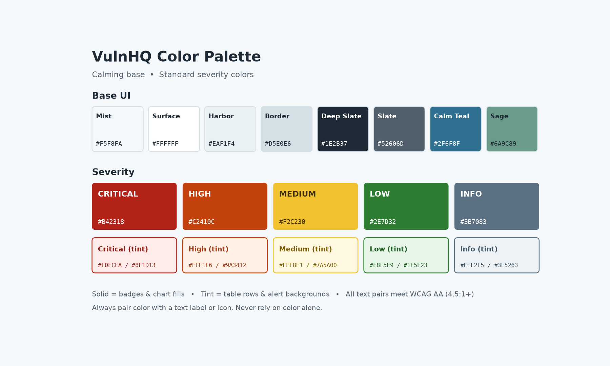

# VulnHQ Design Guide

> **Find it. Rank it. Fix it. Prove it.**

This guide defines how VulnHQ looks, feels and communicates. The goal is simple: **a calm interface where risk stands out.** Security teams already deal with alert fatigue. VulnHQ should feel steady and clear, and color should be saved for what needs action.

All colors, fonts, spacing and other style values are defined as CSS variables in [`src/styles/base.css`](../src/styles/base.css).

---

## Contents

1. [Design Principles](#1-design-principles)
2. [Color](#2-color)
3. [Typography](#3-typography)
4. [Spacing and Layout](#4-spacing-and-layout)
5. [Components](#5-components)
6. [Data Visualization](#6-data-visualization)
7. [Iconography](#7-iconography)
8. [Voice and Microcopy](#8-voice-and-microcopy)
9. [Accessibility](#9-accessibility)
10. [Dark Mode](#10-dark-mode)

---

## 1. Design Principles

| Principle | What it means in practice |
|---|---|
| **Calm by default** | Neutral, soft base colors. No flashing, no unnecessary red. |
| **Risk stands out** | Severity colors appear only on risk data, so they always mean something. |
| **Fix what matters first** | The highest-risk work is always at the top of the screen and the top of the list. |
| **Action over information** | Every screen answers "What should I do next?" |
| **Prove it** | Progress, closure rates and risk reduction are always visible to leadership. |
| **Framework-ready** | Every view can be explained in NIST CSF 2.0 and OWASP terms. See [framework alignment](framework-alignment.md). |

---

## 2. Color



### 2.1 Base UI

| Variable | Name | Hex | Use |
|---|---|---|---|
| `--vhq-bg` | Mist | `#F5F8FA` | App background |
| `--vhq-surface` | Surface | `#FFFFFF` | Cards, panels, modals |
| `--vhq-surface-alt` | Harbor | `#EAF1F4` | Sidebar, table headers |
| `--vhq-border` | Border | `#D5E0E6` | Dividers, outlines |
| `--vhq-text` | Deep Slate | `#1E2B37` | Primary text |
| `--vhq-text-muted` | Slate | `#52606D` | Secondary text, captions |
| `--vhq-primary` | Calm Teal | `#2F6F8F` | Buttons, links, active navigation |
| `--vhq-primary-hover` | Deep Teal | `#24586F` | Hover and pressed states |
| `--vhq-accent` | Sage | `#6A9C89` | Highlights, non-risk charts |
| `--vhq-focus` | Sky | `#7FB3D5` | Keyboard focus ring |

### 2.2 Severity

| Severity | Solid | Text on solid | Tint | Text on tint | Typical criteria |
|---|---|---|---|---|---|
| **Critical** | `#B42318` | `#FFFFFF` | `#FDECEA` | `#8F1D13` | CVSS 9.0–10.0, or on CISA KEV |
| **High** | `#C2410C` | `#FFFFFF` | `#FFF1E6` | `#9A3412` | CVSS 7.0–8.9 |
| **Medium** | `#F2C230` | `#3D2E00` | `#FFF8E1` | `#7A5A00` | CVSS 4.0–6.9 |
| **Low** | `#2E7D32` | `#FFFFFF` | `#E8F5E9` | `#1E5E23` | CVSS 0.1–3.9 |
| **Info** | `#5B7083` | `#FFFFFF` | `#EEF2F5` | `#3E5263` | Informational / no score |

- **Solid:** badges, chart segments, heat-map cells.
- **Tint:** table row highlights, alert banners, card backgrounds.

### 2.3 Remediation Status

Status uses the calm palette, not severity colors, so "Fixed" isn't confused with "Low."

| Status | Hex | Meaning |
|---|---|---|
| Open | `#52606D` | New finding, not yet assigned |
| In Progress | `#2F6F8F` | Owner assigned, work underway |
| Fixed | `#6A9C89` | Remediation applied, awaiting validation |
| Verified | `#1F5A4C` | Rescan confirms the fix |
| Risk Accepted | `#6B5B95` | Approved exception with expiration date |
| Overdue | `#B42318` | SLA breached |

### 2.4 Color Rules

1. Use severity colors **only for risk**, never for decoration or branding.
2. Medium (yellow) always uses **dark text**.
3. Limit any screen to **one dominant severity color**. Let the calm base carry the rest.
4. Never use red for success-related or neutral system messages.

---

## 3. Typography

**Primary font:** [Inter](https://rsms.me/inter/), a clean, highly readable sans-serif built for interfaces.
**Monospace font:** [JetBrains Mono](https://www.jetbrains.com/lp/mono/), used for CVE IDs, hostnames, IPs, ports and code.

| Style | Size / Line height | Weight | Use |
|---|---|---|---|
| Display | 32px / 40px | 700 | Dashboard headline metrics |
| H1 | 24px / 32px | 700 | Page titles |
| H2 | 20px / 28px | 600 | Section titles |
| H3 | 16px / 24px | 600 | Card titles |
| Body | 14px / 22px | 400 | Default text |
| Small | 12px / 18px | 400 | Captions, timestamps, helper text |
| Label | 12px / 16px | 600, uppercase, +0.04em | Badges, table headers |
| Mono | 13px / 20px | 400 | `CVE-2026-12345`, `10.0.4.21:443` |

**Rules**
- Use sentence case for headings and buttons ("Assign owner," not "Assign Owner").
- Use tabular numbers (`font-variant-numeric: tabular-nums`) in tables and metrics so digits line up.
- Keep line length between 60 and 80 characters for long-form text.

---

## 4. Spacing and Layout

### 4.1 Spacing Scale (4px base)

| Variable | Value | Use |
|---|---|---|
| `--vhq-space-1` | 4px | Icon-to-text gap |
| `--vhq-space-2` | 8px | Inside badges, tight groups |
| `--vhq-space-3` | 12px | Form field padding |
| `--vhq-space-4` | 16px | Card padding, default gap |
| `--vhq-space-6` | 24px | Between cards and sections |
| `--vhq-space-8` | 32px | Page padding |
| `--vhq-space-12` | 48px | Major page sections |

### 4.2 Radius and Elevation

| Variable | Value | Use |
|---|---|---|
| `--vhq-radius-sm` | 4px | Inputs, small buttons |
| `--vhq-radius-md` | 8px | Cards, panels |
| `--vhq-radius-lg` | 12px | Modals |
| `--vhq-radius-pill` | 999px | Badges, chips |
| `--vhq-shadow-sm` | `0 1px 2px rgba(30,43,55,.06)` | Cards |
| `--vhq-shadow-md` | `0 4px 12px rgba(30,43,55,.08)` | Dropdowns, popovers |
| `--vhq-shadow-lg` | `0 12px 32px rgba(30,43,55,.12)` | Modals |

### 4.3 App Layout

```
┌──────────────────────────────────────────────────────────┐
│ Top bar: search · environment · notifications · profile │
├────────────┬─────────────────────────────────────────────┤
│            │ Page title + primary action                 │
│  Sidebar   ├─────────────────────────────────────────────┤
│  (Harbor)  │ KPI cards: Critical open · Overdue · MTTR   │
│            ├─────────────────────────────────────────────┤
│ Dashboard  │                                             │
│ Fix List   │ Main content (ranked table, charts)         │
│ Assets     │                                             │
│ Findings   │                                             │
│ Exceptions │                                             │
│ Reports    │                                             │
│ Settings   │                                             │
└────────────┴─────────────────────────────────────────────┘
```

- **Sidebar:** 240px expanded, 64px collapsed.
- **Content max width:** 1440px, centered.
- **Grid:** 12 columns, 24px gutters.
- **Breakpoints:** 640px (mobile), 1024px (tablet), 1280px (desktop), 1536px (wide).

---

## 5. Components

### 5.1 Buttons

| Variant | Style | Use |
|---|---|---|
| Primary | Calm Teal fill, white text | One main action per screen ("Assign owner") |
| Secondary | White fill, teal border and text | Supporting actions ("Export") |
| Ghost | No border, teal text | Low-emphasis actions ("Cancel") |
| Danger | Critical red fill, white text | Destructive actions only ("Delete asset") |

Height: 36px default, 32px compact. Always show a visible focus ring (`--vhq-focus`, 2px offset).

### 5.2 Severity Badge

```html
<span class="vhq-badge vhq-badge--critical">
  <svg aria-hidden="true"><!-- icon --></svg> Critical
</span>
```

- Always include the **text label**, plus an icon for quick scanning.
- Pill shape, uppercase label style.

### 5.3 Status Chip

Outline style with a colored dot and label. This keeps it visually distinct from solid severity badges.

`● In Progress` · `● Verified` · `● Overdue`

### 5.4 KPI Card

| Element | Spec |
|---|---|
| Label | Small, Slate |
| Value | Display, Deep Slate (or severity color for Critical/Overdue counts) |
| Trend | Arrow with % change. A **decrease in risk is good**, so show it in sage, not red. |
| Action | Optional link ("View 12 critical") |

### 5.5 Fix List Table

The core VulnHQ screen.

| Column | Notes |
|---|---|
| Rank | `#1`, `#2`… by VulnHQ Risk Score |
| Severity | Badge |
| Finding | Title + mono CVE ID |
| Asset | Hostname (mono) + criticality tier |
| Exploitability | KEV and EPSS indicators |
| Owner | Avatar + name |
| SLA | Days remaining; turns Overdue red when breached |
| Status | Status chip |

- Header row uses Harbor background and Label typography.
- Critical rows may use a **left 4px border** in the critical color instead of a full tint, to keep the table calm.
- Default sort: Risk Score, descending.

### 5.6 Alerts and Banners

| Type | Background | Border / Icon | Use |
|---|---|---|---|
| Info | Info tint | Info | System messages |
| Success | Low tint | Low | "12 findings verified" |
| Warning | Medium tint | Medium | "3 findings approaching SLA" |
| Error | Critical tint | Critical | Failed imports, breached SLAs |

### 5.7 Forms

- Labels go above fields, never only as placeholder text.
- Field height 36px, Border color, 4px radius.
- Errors: critical red text below the field with an icon, plus `aria-describedby`.

### 5.8 Framework Tags

Small outline chips that show which framework outcome a finding or report supports.

`CSF ID.RA-05` · `OWASP A05:2025` · `BOD 26-04`

| Property | Spec |
|---|---|
| Background | Harbor `#EAF1F4` |
| Border | Border `#D5E0E6` |
| Text | Slate `#52606D`, Mono 12px |
| Radius | 4px (`--vhq-radius-sm`) |

- Never use severity colors for framework tags. Frameworks describe *context*, not *risk level*.
- Tags link to the matching section in the [framework alignment](framework-alignment.md).

---

## 6. Data Visualization

- **Severity charts** use the solid severity colors, always in order: Critical → High → Medium → Low → Info.
- **Non-risk charts** (assets by type, scans over time) use the calm palette: Calm Teal, Sage, Sky `#7FB3D5`, Slate.
- **Trend lines:** risk going down = sage; risk going up = critical red.
- Always include **direct labels or a legend with text**. Never rely on color alone.
- Avoid 3D charts and pie charts with more than 5 slices.

**Recommended charts**

| Question | Chart |
|---|---|
| What's open by severity? | Horizontal stacked bar |
| Are we getting better? | Line chart of open criticals / MTTR over time |
| Where is risk concentrated? | Heat map: asset tier × severity |
| Are we meeting SLAs? | Bar chart: on-time vs overdue by team |

---

## 7. Iconography

- **Library:** [Lucide](https://lucide.dev/), an open-source, consistent line-icon set.
- **Sizes:** 16px (inline), 20px (buttons, nav), 24px (empty states).
- **Stroke:** 1.75px, color inherits from text.

| Concept | Icon |
|---|---|
| Critical | `octagon-alert` |
| High | `triangle-alert` |
| Medium | `circle-alert` |
| Low | `circle-check` |
| Info | `info` |
| Asset | `server` |
| Exploited (KEV) | `flame` |
| Owner | `user` |
| SLA | `clock` |
| Verified | `shield-check` |

---

## 8. Voice and Microcopy

VulnHQ sounds like a **calm, confident security lead**: direct, helpful and never alarmist.

| Do | Don't |
|---|---|
| "12 critical findings need an owner." | "WARNING!!! CRITICAL VULNERABILITIES DETECTED!" |
| "Fix these 5 first to cut risk by 40%." | "You have 3,482 vulnerabilities." |
| "Nice work. Critical backlog is down 18% this month." | "Task completed successfully." |
| "Import failed: column `cve_id` is missing." | "An error occurred." |

**Rules**
- Lead with the action or the outcome.
- Use numbers to show progress.
- Celebrate wins. Remediation is hard work.
- Spell out acronyms on first use in help text (for example, "EPSS (Exploit Prediction Scoring System)").

**Empty states**
- Fix List with no items: "Nothing to fix right now. Your backlog is clear."
- No data imported: "Import your first scan to build your fix list." + primary button.

---

## 9. Accessibility

VulnHQ targets **WCAG 2.2 AA**.

1. All text/background pairs meet **4.5:1** contrast (3:1 for large text and UI borders).
2. **Never rely on color alone.** Severity always shows a label, and status always shows text.
3. Every interactive element is **keyboard accessible** with a visible focus ring.
4. Minimum click/tap target: **24×24px** (44×44px preferred on touch).
5. Tables use proper `<th scope>` headers. Sortable columns announce their sort state.
6. Respect `prefers-reduced-motion`: no animations beyond simple fades.
7. Charts include a text summary or data-table alternative.

---

## 10. Dark Mode

Dark mode is a **calm night palette**: the base colors change, and the severity solids stay the same so meaning doesn't shift.

| Variable | Light | Dark |
|---|---|---|
| `--vhq-bg` | `#F5F8FA` | `#121B22` |
| `--vhq-surface` | `#FFFFFF` | `#1A262F` |
| `--vhq-surface-alt` | `#EAF1F4` | `#22313C` |
| `--vhq-border` | `#D5E0E6` | `#2E3F4C` |
| `--vhq-text` | `#1E2B37` | `#E3EBF0` |
| `--vhq-text-muted` | `#52606D` | `#A3B3BF` |
| `--vhq-primary` | `#2F6F8F` | `#7FB3D5` |

Toggle with `data-theme="dark"` on the `<html>` element. Default to the user's system setting (`prefers-color-scheme`).

---

© 2026 Cyber Christy LLC. All rights reserved.
