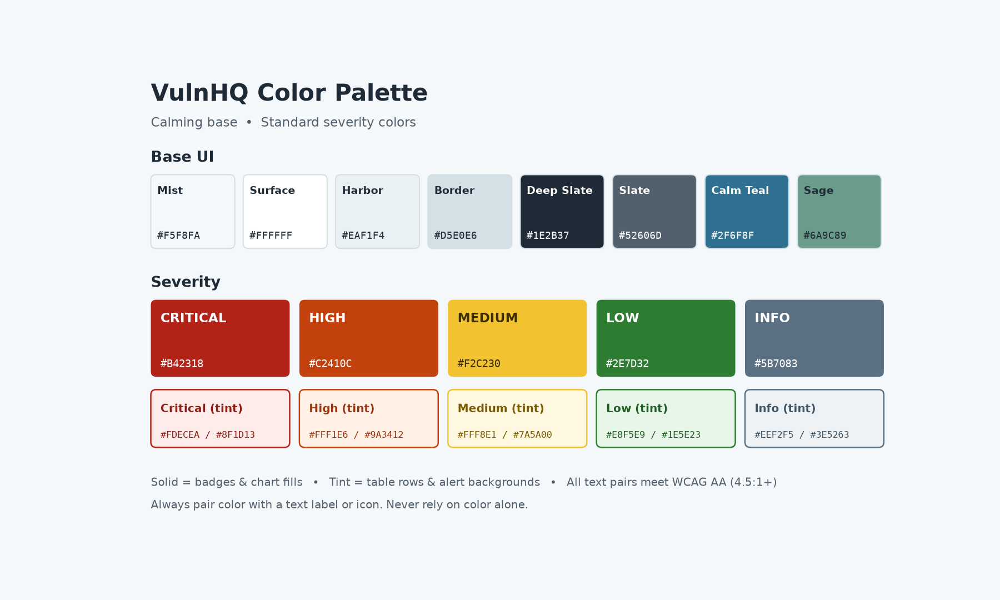

# VulnHQ Color System

VulnHQ pairs a **calming base palette** (mist, slate, teal and sage) with **standard severity colors** (red, orange, yellow, green and gray-blue). The interface stays quiet, so risk colors stand out only where they matter.

Tokens are defined in [`src/styles/tokens.css`](../src/styles/tokens.css).

## Base UI

| Token | Name | Hex | Use |
|---|---|---|---|
| `--vhq-bg` | Mist | `#F5F8FA` | App background |
| `--vhq-surface` | Surface | `#FFFFFF` | Cards, panels |
| `--vhq-surface-alt` | Harbor | `#EAF1F4` | Sidebar, table headers |
| `--vhq-border` | Border | `#D5E0E6` | Dividers, outlines |
| `--vhq-text` | Deep Slate | `#1E2B37` | Primary text |
| `--vhq-text-muted` | Slate | `#52606D` | Secondary text |
| `--vhq-primary` | Calm Teal | `#2F6F8F` | Buttons, links, active nav |
| `--vhq-accent` | Sage | `#6A9C89` | Highlights, non-risk charts |
| `--vhq-focus` | Sky | `#7FB3D5` | Keyboard focus ring |

## Severity

| Severity | Solid | Text on solid | Tint | Text on tint | Typical criteria |
|---|---|---|---|---|---|
| **Critical** | `#B42318` | `#FFFFFF` | `#FDECEA` | `#8F1D13` | CVSS 9.0–10.0, or on CISA KEV |
| **High** | `#C2410C` | `#FFFFFF` | `#FFF1E6` | `#9A3412` | CVSS 7.0–8.9 |
| **Medium** | `#F2C230` | `#3D2E00` | `#FFF8E1` | `#7A5A00` | CVSS 4.0–6.9 |
| **Low** | `#2E7D32` | `#FFFFFF` | `#E8F5E9` | `#1E5E23` | CVSS 0.1–3.9 |
| **Info** | `#5B7083` | `#FFFFFF` | `#EEF2F5` | `#3E5263` | Informational / no score |

- **Solid colors:** badges, chart segments, heat-map cells.
- **Tint colors:** table row highlights, alert banners, card backgrounds.

## Remediation Status

Status uses the calm palette, not severity colors, so that "Fixed" isn't confused with "Low."

| Status | Hex |
|---|---|
| Open | `#52606D` |
| In Progress | `#2F6F8F` |
| Fixed | `#6A9C89` |
| Verified | `#1F5A4C` |
| Risk Accepted | `#6B5B95` |
| Overdue (SLA breached) | `#B42318` |

## Accessibility Rules

1. Every text/background pair meets **WCAG AA** contrast (4.5:1 or higher).
2. **Never rely on color alone.** Always show the severity label (for example "CRITICAL") or an icon.
3. Medium (yellow) always uses **dark text**, never white.
4. Use severity colors **only for risk**, not for decoration, so they keep their meaning.
5. Dark mode changes the base palette but keeps the severity solids the same.
